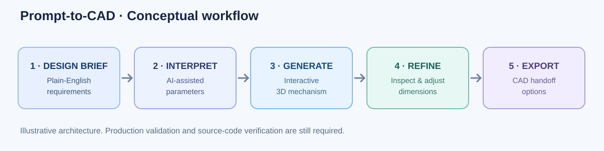

# Prompt-to-CAD — AI-Assisted Mechanical Design Prototype

**From a natural-language design request to an interactive mechanical model.**

Prompt-to-CAD is a personal engineering prototype exploring how AI-assisted input interpretation and parametric modeling can speed up the earliest stages of mechanical design.

> **Portfolio case study, not a runnable source release.** The original application's source code was not available in the materials provided for this publication. This directory documents the demonstrated workflow. It does not contain the working CAD-generation app.

## Demonstrated workflow

1. **Describe:** Enter an engineering request in natural language.
2. **Generate:** View an initial 3D mechanical concept.
3. **Inspect:** Orbit, zoom, and review the modeled mechanism.
4. **Refine:** Change parameters and request design adjustments.
5. **Export:** Access CAD/mesh output options shown in the user interface for subsequent design work.

## Examples shown in the recorded demo

| Mechanism | Demonstration |
| --- | --- |
| Planetary gearset | Interactive geometry and parametric changes |
| Rack and pinion | Alternate mechanism generation |
| Threaded fastener | Additional component example |

The interface also displays CAD export options and engineering/manufacturability feedback. These were visible in the demonstration; the exported files and numerical engineering results have **not** been independently tested for this portfolio entry.

## Why build this?

Engineering teams spend time translating requirements into preliminary geometry, configuring standard components, and iterating on variants. Focused internal AI tools may help automate the repetitive steps while retaining human review for design decisions.

The guiding idea is **AI for interpreting design intent, conventional engineering logic for geometry and verification**. This is an intended architecture, not a source-code audit.

## Status and limitations

- **Status:** Recorded prototype and portfolio documentation.
- **Not included:** Original application source, build instructions, dependency manifest, live deployment, automated tests, or downloadable demonstration video.
- **Not established:** Benchmark time savings, reliability across prompts, production-level geometric accuracy, or validated manufacturing readiness.
- **Next steps:** Add original source and license; provide reproducible setup; test dimensions, gear meshing, clearances, CAD exports, edge cases, and failure behavior; measure results against manual workflows.

## Portfolio materials

- [One-page case study](index.html) — self-contained HTML overview.
- [Project summary and résumé bullet](PORTFOLIO_ENTRY.md).
- [Workflow illustration](workflow.svg) — conceptual, not a screenshot.

**Project category:** Mechanical Engineering · CAD · AI-Assisted Design

**Note:** A separate edited LinkedIn video exists in the original project materials but was not uploaded here. The presentation should not be confused with the full source implementation.
